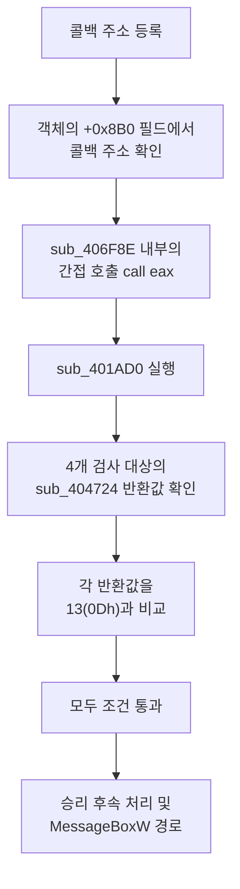
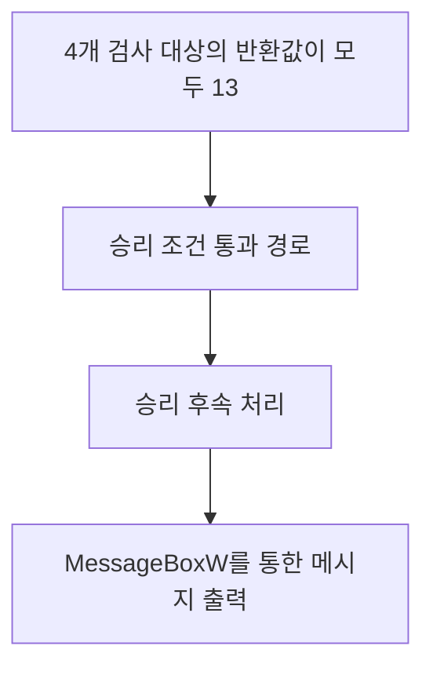

# SOL.EXE 승리 조건 리버싱 분석

> 대상: `SOL.EXE` 32비트 바이너리
>
> 범위: 승리 조건 검사 흐름만 정리
>
> 상태: 정적 분석 기록. 

## 1. 분석 범위와 결론 요약

이번에는 승리 판정에 관여하는 것으로 보이는 콜백 함수 `sub_401AD0`을 중심으로 다음 흐름을 추적했다.



코드만 보고 확정할 수 있는 핵심은 **4개의 검사 대상에 대해 `sub_404724`의 반환값이 각각 `13`인지 확인하고, 하나라도 다르면 해당 검사 루틴을 빠져나간다**는 점이다. 이 4개 대상이 게임 화면의 네 파운데이션이라는 해석은 객체 초기화와 배열 사용 흐름을 바탕으로 한 **파운데이션 관련 추정**으로 따로 구분했다.

## 0. 먼저 결론부터 이해하기

SOL.EXE의 실제 흐름은 다음과 같이 보면 된다.

1. 게임 객체에 승리 검사 함수를 등록한다.
2. 카드나 객체를 처리하는 과정에서 등록된 함수를 호출한다.
3. 검사 함수는 4개의 대상을 하나씩 확인한다.
4. 각 대상의 상태값을 계산한 뒤 그 값이 `13`인지 비교한다.
5. 하나라도 `13`이 아니면 승리 경로를 중단한다.
6. 네 대상이 모두 조건을 통과하면 승리 후속 처리와 `MessageBoxW` 호출로 이어진다.

여기서 중요한 점은 “4개의 대상이 정확히 무엇인지”와 “13이 정확히 무엇을 뜻하는지”를 구분하는 것이다. 코드가 직접 보여 주는 것은 **4개의 반환값을 13과 비교한다는 사실**이다. 따라서 이것만으로 “네 파운데이션에 카드가 각각 13장 있다”고 확정하면 안 된다.

## 2. `sub_401AD0`: 승리 조건 검사 함수

### 2.1 함수 역할 추적

분석은 `sub_401AD0` 내부에서 반복적으로 호출되는 상태 계산 함수 `sub_404724`와 그 직후의 비교 분기부터 시작했다.

```asm
call sub_404724
cmp  eax, 0Dh
jnz  loc_401BC8
```

이 코드는 다음처럼 읽으면 된다.

1. `sub_404724`를 호출한다.
2. 반환값을 `EAX`에서 받는다.
3. 반환값을 16진수 `0Dh`, 즉 10진수 `13`과 비교한다.
4. 같지 않으면 `loc_401BC8`로 분기해서 현재 승리 검사 경로를 끝낸다.

함수 전체가 같은 형태의 검사를 4회 수행하는 것으로 확인되었으므로, 분석 결과를 의사 코드로 나타내면 다음과 같다.

```c
void check_win_condition(void) {
    // 실제 원본 소스가 아니라 정적 분석 기반 의사 코드
    sub_4030FC();

    for (int i = 0; i < 4; i++) {
        int state = sub_404724(nIDEvent[i]);
        if (state != 13) {
            return;
        }
    }

    // 네 번의 검사를 모두 통과한 뒤의 승리 후속 처리
}
```

### 2.2 확정 사실과 해석의 경계

| 구분 | 내용 |
|---|---|
| 확정 사실 | `sub_404724` 반환값을 `13`과 비교하는 코드가 존재한다. |
| 확정 사실 | 불일치 시 `jnz loc_401BC8` 경로로 빠진다. |
| 확정 사실 | 동일한 검사 흐름이 4개 대상에 대해 반복된다. |
| 추정 | 각 대상이 게임 화면의 네 파운데이션 객체일 가능성이 높다. |
| 미확인 | 패치했을 때 실제 게임 동작이 어떻게 달라지는지. |

## 3. `sub_404724`: 검사값을 계산하는 함수

`sub_401AD0`은 직접 카드 수를 세기보다 `sub_404724`를 호출하고, 그 반환값만 `13`과 비교한다. 따라서 실제 상태값의 계산은 `sub_404724` 내부에서 수행되는 것으로 볼 수 있다.

분석 순서는 다음과 같다.

1. `sub_401AD0`에서 `call sub_404724`를 확인한다.
2. 호출 직후 `EAX`가 `cmp eax, 0Dh`에 사용되는지 확인한다.
3. `sub_404724` 내부에서 객체 필드와 연결 리스트 또는 카운트 관련 필드가 어떻게 참조되는지 추적한다.
4. 반환값이 승리 검사에서 사용되는 상태값이라는 점을 호출자 관점에서 확정한다.

여기서 `13`을 곧바로 “카드 13장”이라고 단정하는 것은 주의해야 한다. 반환값이 카드 개수나 완료 상태를 나타낼 가능성은 있지만, `sub_404724`의 내부 필드 의미와 자료구조를 모두 검증해야 하기 때문이다. 이번 문서에서는 호출 규약과 비교 관계는 사실로 기록하고, 반환값의 구체적 의미는 문맥 기반 해석으로 남긴다.

## 4. `nIDEvent`와 4개 검사 대상 추적

이전 분석에서는 `sub_401AD0`이 4개의 이벤트/객체 식별자를 순회하며 `sub_404724`에 전달하는 구조로 정리했다. 이를 설명하기 위해 사용한 개념적 표현은 다음과 같다.

```c
for (int i = 0; i < 4; i++) {
    int state = sub_404724(nIDEvent[i]);
    // state == 13인지 검사
}
```

`nIDEvent[0]`부터 `[3]`까지가 네 개의 동일한 게임 객체를 가리킨다는 점은 반복 구조와 객체 초기화 흐름에서 추론할 수 있다. 다만 현재 대화에서 확보된 캡처와 기록만으로는 각 인덱스가 구체적으로 어떤 화면 위치 또는 어떤 파운데이션에 매핑되는지까지 확정하지 않는다.

따라서 보고서에서 안전한 표현은 다음과 같다.

> `sub_401AD0`은 `nIDEvent`로 표현된 4개 검사 대상의 상태값을 계산하고, 각 결과가 13인지 확인한다. 이 대상들은 게임의 네 파운데이션일 가능성이 있으나, 인덱스별 객체 매핑은 추가 추적이 필요하다.

## 5. 콜백 등록: `sub_403FB6`

`0x8B0` 오프셋에 대한 교차 참조를 확인하면서 다음 명령어를 찾았다.

```asm
; .text:00403FBC, sub_403FB6
mov [ecx+8B0h], eax
```

이 명령은 `EAX`에 들어 있는 값을 객체 구조체의 `+0x8B0` 위치에 저장한다. 앞선 함수 분석에서 `EAX`가 `sub_401AD0`의 주소로 준비되는 흐름이 확인되었으므로, `sub_403FB6`은 해당 객체에 승리 검사 콜백을 등록하는 함수로 해석된다.

### 캡처 1 — `0x8B0` 필드의 교차 참조


IDA의 교차 참조 목록에는 다음과 같은 사용 지점이 표시된다.

| 주소 | 함수 | 명령어 | 분석상 의미 |
|---|---|---|---|
| `00403FBC` | `sub_403FB6` | `mov [ecx+8B0h], eax` | 콜백 주소 저장 |
| `00404493` | `sub_404368` | `mov dword ptr [ebx+8B0h], 0` | 콜백 필드 초기화 |
| `00404B8E` | `sub_404AEC` | `mov eax, [eax+8B0h]` | 콜백 주소 읽기 |
| `0040719E` | `sub_406F8E` | `mov eax, [esi+8B0h]` | 콜백 주소 읽기 |

여기서 확정 가능한 것은 `+0x8B0`이 여러 함수에서 저장·초기화·읽기되는 함수 포인터성 필드라는 점이다. `sub_403FB6`이 승리 검사 콜백을 등록한다는 해석은 `EAX`에 어떤 주소가 전달되는지와 함께 판단한다.

## 6. 콜백 실행: `sub_406F8E`

`sub_406F8E` 내부에서 객체의 `+0x8B0` 필드를 읽은 뒤 NULL 여부를 검사하고, NULL이 아니면 간접 호출하는 흐름을 확인했다.

```asm
loc_407198:
mov  esi, [ebp+var_42C]
mov  eax, [esi+8B0h]
test eax, eax
jz   short loc_4071B7

lea  edx, [esi+8]
mov  [esp+448h+xLeft], edx
mov  [esp+448h+lprc], esi
call eax
sub  esp, 8
```

### 캡처 2 — `sub_406F8E`의 간접 콜백 호출


명령어별 의미는 다음과 같다.

| 명령어 | 의미 |
|---|---|
| `mov esi, [ebp+var_42C]` | 지역 변수에서 객체 주소를 가져온다. |
| `mov eax, [esi+8B0h]` | 객체에 저장된 콜백 주소를 읽는다. |
| `test eax, eax` | 콜백 주소가 NULL인지 검사한다. |
| `jz short loc_4071B7` | NULL이면 호출하지 않고 건너뛴다. |
| `lea edx, [esi+8]` | 객체 내부 필드의 주소를 인자로 준비한다. |
| `mov [esp+...], ...` | 콜백 호출 인자를 스택에 배치한다. |
| `call eax` | 읽어 온 함수 포인터를 간접 호출한다. |

이 코드로부터 `sub_406F8E`이 저장된 콜백을 실제로 실행한다는 사실은 확정할 수 있다. 또한 `+0x8B0`에 `sub_401AD0` 주소가 등록되어 있다는 앞선 분석과 결합하면, 특정 객체 처리 시점에 승리 검사 함수가 콜백으로 호출되는 실행 경로를 재구성할 수 있다.

단, 캡처에 보이는 `xLeft`, `lprc`라는 IDA 변수명만으로 실제 게임 인자의 의미를 확정해서는 안 된다. 이 변수들은 IDA가 붙인 이름일 수 있으며, 정확한 의미는 호출 대상 함수의 인자 사용과 구조체 정의를 추가로 확인해야 한다.

## 7. 승리 메시지: `MessageBoxW`

승리 조건 검사 통과 이후의 후속 처리에는 `MessageBoxW` 호출이 포함된 것으로 확인했다. 따라서 정적 호출 흐름에서는 다음을 구분해야 한다.



`MessageBoxW` 호출은 사용자에게 승리 메시지를 보여 주는 증거가 되지만, 이 호출만으로 점수·애니메이션·게임 상태 저장 등 모든 승리 후속 처리가 동일한 조건에 종속된다고 단정할 수는 없다. 

## 8. 전체 추적 절차

### 단계 1 — 승리 메시지의 API 호출에서 역추적

`MessageBoxW` 호출을 찾고, 호출 직전의 분기와 상위 블록을 따라가 승리 메시지에 도달하는 조건을 확인한다.

### 단계 2 — 비교 명령어 확인

`sub_401AD0`에서 다음 패턴을 찾는다.

```asm
call sub_404724
cmp  eax, 0Dh
jnz  loc_401BC8
```

이 패턴을 통해 승리 검사에서 비교되는 값과 불일치 시의 탈출 경로를 확인한다.

### 단계 3 — 반복 횟수와 검사 대상 확인

같은 비교 블록이 4개 대상에 대해 반복되는지 확인하고, `nIDEvent` 배열 또는 이에 해당하는 객체 식별자의 흐름을 추적한다.

### 단계 4 — 상태 계산 함수로 이동

`sub_404724`로 들어가 반환값이 어떤 객체 필드와 자료구조를 기반으로 계산되는지 확인한다. 여기서 “13”의 의미를 카드 수로 해석하려면 내부 계산을 추가로 검증해야 한다.

### 단계 5 — 콜백 저장 필드의 교차 참조 검색

`+0x8B0` 오프셋의 사용 지점을 검색해 등록 함수(`sub_403FB6`), 초기화 함수(`sub_404368`), 읽기 함수(`sub_404AEC`, `sub_406F8E`)를 분류한다.

### 단계 6 — 간접 호출 확인

`sub_406F8E`에서 `mov eax, [esi+8B0h]` 이후 `call eax`가 실행되는지 확인한다. 이 단계에서 콜백의 등록과 실행이 연결된다.

## 9. 최종 판정과 남은 불확실성

### 확인된 사실

- `sub_401AD0`은 승리 조건 검사에 관여하는 함수다.
- `sub_404724`의 반환값은 `EAX`를 통해 호출자에게 전달된다.
- 반환값은 `cmp eax, 0Dh`를 통해 13과 비교된다.
- 4개 검사 대상에 대해 같은 형태의 검사가 수행된다.
- `sub_403FB6`은 객체의 `+0x8B0` 필드에 함수 포인터를 저장한다.
- `sub_406F8E`은 `+0x8B0`에서 함수 포인터를 읽고 NULL이 아니면 `call eax`로 호출한다.
- 승리 통과 경로에는 `MessageBoxW` 호출이 연결되어 있다.

### 파운데이션 관련 추정

- 4개의 검사 대상은 게임의 네 파운데이션 객체일 가능성이 높다.
- `sub_404724`의 반환값 13은 파운데이션의 완료 상태 또는 카드 수와 관련될 가능성이 있다.
- 콜백은 카드 이동 또는 객체 상태 변화 이후 실행되는 승리 검사일 가능성이 있다.
