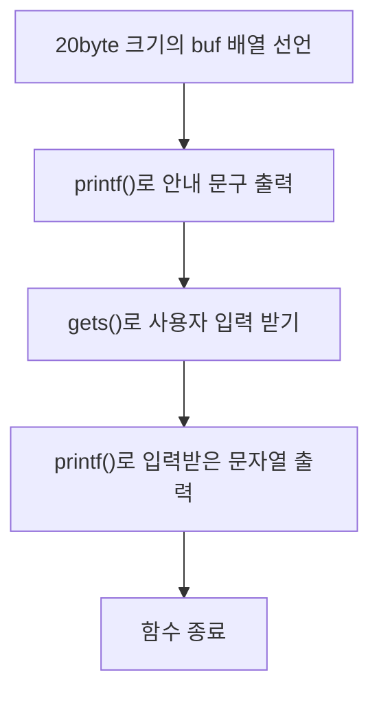

## Buffer overflow
### 메모리 오염 공격
의미: 프로그램의 메모리 공간에 허용된 용량보다 많은 데이터를 주입하여 인접한 메모리 영역의 데이터를 덮어쓰거나 손상시키는 공격
-> 이것의 종류 중 하나가 Buffer overflow (+ Use-After-Free, Null Pointer Dereference)
### Buffer overflow
의미: 할당된 버퍼의 크기보다 더 많은 데이터를 입력하여 인접한 메모리 영역까지 덮어쓰는 취약점
종류: 스택/힙 버퍼 오버플로우(발생 위치에 따라 나뉨)
### Stack Buffer Overflow
#### 발생 원리
프로그램 내 크기에 제한이 있는 버퍼에 그 크기보다 더 큰 값이 입력으로 들어올 경우 해당 값이 버퍼의 메모리 공간을 넘어가 다른 메모리를 침범(오염) 시키게 된다.
#### 예시
```c
void vuln(){
	char buf[12];
	printf("input: ");
	gets(buf);
}
int main(){
	vuln();
	puts("done");
	return 0;
}
```
gets()는 입력 길이의 제한이 없지만, buf는 12byte로 제한을 둠 -> 근데 더 입력 가능 => 컴파일 시 경고 발생

#### Ret Overwrite
1. 개요
위의 예시에서 vuln() 함수가 끝난 뒤, CPU에서는 main의 어디로 돌아가야 하는지 알기 위해 Return Address(반환 주소)를 사용한다. 
- 사용 예시: main()에서 vuln() 호출 -> call 명령어가 vuln() 실행이 끝난 뒤 돌아올 명령어의 주소를 stack에 저장 -> ret이 stack에 저장된 Return Address를 꺼내 EIP에 저장하여 해당 주소로 실행 위치 변경
=> 이게 buffer overflow와 무슨 연관?
: Return address도 stack 공간을 차지하고 있는데, 그 아래 있는 buf가 overflow 될 때 경우에 따라 Return Address까지 도달하면 기존의 Return Address가 다른 값으로 덮어씌워진다.

2. 동작 원리
정의: Buffer overflow를 이용해 stack 공간의 Return Address 값을 다른 값(공격자가 원하는)으로 덮어쓰는 것
-> 단순히 의미 없는 값이 아니라 공격자가 지정한 위치로 실행 흐름을 이동시켜 공격자가 원하는 함수를 실행시킨다면? Control Hijacking 발생

## Shellcode Injection
1.개요
Ret overwrite를 통해 Return Address 조작을 하면 공격자가 원하는 대로 프로그램 실행 흐름을 변경할 수 있다는 것을 알았다. 그렇다면 실제 공격 기법에 대해 알아보자.

2.정의
Shellcode: 프로그램의 취약점을 이용해 공격자가 원하는 동작을 수행하도록 만든 기계어 코드

### Shellcode Injection
1.정의
Stack에 Shellcode를 넣어두고, 반환 주소가 Stack의 shellcode로 가게 하는 공격

2.방법: 
Stack에 Shellcode 주입 -> Return Address를 shellcode가 위치한 곳의 주소로 덮어씌우기 -> EIP가 shellcode를 가리키게 되면서 shellcode가 실행됨

#### 정수 바이트 값 메모리 저장 방식
1.Big-endian(빅 엔디안): 상위 바이트부터 낮은 주소로 배치
예시. 낮은 주소 [12 34 56 78] 높은 주소
2.Little-endian(리틀 엔디안): 하위 바이트부터 낮은 주소로 배치
예시. 낮은 주소 [78 56 34 12] 높은 주소
=> shellcode가 위치한 곳의 주소값을 덮어씌울 때 little-endian인지 big-endian인지에 따라 어떻게 넣는지가 달라짐

#### 방어 기법 - NX bit
1.Shellcode Injection이 가능한 이유
: Stack memory에 실행과 쓰기 권한이 모두 주어져 있음 -> 공격자 입장에서는 공격 코드를 쓰고 실행하는 게 가능함

2.W^X 정책과 NX bit
W^X 정책: 한 메모리 구간 안에 쓰기와 실행 권한은 함께 두지 않는 정책.
NX bit: W^X 정책을 적용한 하드웨어 기능으로, 특정한 메모리 영역에서 코드 실행을 금지하도록 지정할 수 있다.

## 코드 재사용 공격
1.등장 이유
NX bit은 공격자가 실행 가능한 영역에 새로운 명령어를 write 하는 것을 막음
-> 그렇다면? 이미 들어가 있는 코드를 사용해 보기

2.방법
목표 함수의 주소를 구하고, 취약한 함수의 stack frame에서 Return Address의 공간을 구한 목표 함수의 주소로 덮어쓰기

### 코드 재사용 공격 - 실습(ret2win)
ret2win이란?
: Buffer overflow를 이용해 Return Address를 덮어쓰고, 프로그램에 이미 존재하는 특정 함수를 실행시키는 공격 방식

#### 문제 파일 확인

ls -l 명령어 실행을 통해 sample이 실행 권한이 있는 파일임을 알 수 있음


file sample 명령어 실행을 통해 실행 권한이 있는 파일 sample의 환경을 알 수 있음: ELF 32-bit LSB executable, Intel 80386
<div style="margin-left: 1.5rem;">ELF: Linux에서 사용하는 실행 파일 형식<br>
32-bit: 32비트 실행 파일<br>
<span style="color: orange;">LSB: Little Endian 방식<br>
Intel 80386: x86 32비트 아키텍처</span>
=> 32 bit architecture, little endian
</div>

실행 파일에 적용된 보안 기법 확인
<div style = "margin-left: 1.5rem;">NX NX enabled: 스택 등 비실행 메모리에서 코드 실행 제한<br>PIE No PIE: 실행 파일 코드 주소가 PIE로 무작위화 되지 않음<br>=> stack에 shellcode를 직접 넣어 실행할 수는 없지만, 실행 파일 내부 함수 주소 예측은 가능함
</div>

#### sample.c 소스코드 분석
```c
#include<stdio.h>
#include<stdlib.h>

void target(){
	setregid(getgid(), getegid());
	system("/bin/sh");
}

void func(int value){
	char buf[20];
	printf("input: ");
	gets(buf);
	printf("buf: %s\n", buf);
}

int main(){
	int num = 5;
	func(num);
}
```
<div style = "margin-left: 1.5rem;">1.함수 func()<br>
gets()로 buf에 입력을 받지만, 크기 체크를 하지는 않음 -> BOF 취약점 가능성 있음</div>

<div style = "margin-left: 1.5rem;">2.함수 target()<br>
setregid()로 권한 상승이 가능하고, system()으로 쉘이 실행됨 -> 그룹 권한을 사용할 수 있어짐</div>

#### 스택 프레임 분석

<div style="margin-left: 1.5rem;">1. 어디를 분석해야 하는가?<br>
c 코드를 가지고 파악해 보면, func 함수는 다음과 같은 순서로 진행된다.</div>



<div style="margin-left: 1.5rem;">2. 스택 프레임 분석<br>
함수 시작 부분</div>

```asm
push ebp
mov ebp, esp
push ebx
sub esp, 0x24
```
PIC 주소 계산 - 함수 본문 실행을 위한 준비 작업
```asm
call ~ ; 보조 함수. 현재 코드의 실행 위치를 ebx 레지스터에 저장하는 역할이다.
add ebx, 0x2d93 ; 기준 주소 계산용
```
첫 번째 printf() 호출
```asm
sub esp, 0xc
lea eax, [ebx-0x1ff0] ;"input: " 문자열의 주소를 계산하여 eax에 저장
push eax ; 저장된 eax의 주소를 printf()로 전달
call ~ <printf@plt> ; printf() 함수 호출
add esp, 0x10
```
<span style="color: orange;">gets() 호출</span>
```asm
sub esp, 0xc
lea eax, [ebp-0x1c]
push eax
call gets@plt
add esp,0x10
```
두 번째 printf() 호출
```asm
sub esp, 0x8
lea eax, [ebp-0x1c]
push eax
lea eax, [ebx-0x1fe8]
push eax
call ~ <printf@plt>
```
ESP, EBX 정리
```asm
add esp, 0x10
nop
mov ebx, DWORD PTR [ebp-0x4]
```
epilogue
```asm
leave
ret
```
<div style = "margin-left: 1.5rem;">3. gets()<br>
이 함수에서 알고 싶은 점: gets()에는 어떤 값이 전달되는가?<br>
buf[20]은 stack의 어느 주소에 위치하는가?<br>
buf에서 Return Address까지의 거리는 얼마인가?<br>
</div>

##### gets()에 전달되는 값
```
lea eax, [ebp-0x1c]
push eax
```
이 부분을 보면, eax에 ebp에서 0x1c만큼 뺀 위치의 주소값을 저장함을 알 수 있다. 그리고 그 값은 gets에 인자로 전달된다. 그러므로, gets()에는 ebp에서 0x1c만큼 아래 위치 주소가 전달됨을 알 수 있다.

##### buf[20]은 stack의 어느 주소에 위치하는가?
c 코드를 확인해 보면 gets(buf)이다. 그러므로 위에서 확인한 gets에 인자로 전달되는 ebp-0x1c 주소 = buf의 시작 주소임을 알 수 있다.

##### buf에서 Return Address까지의 거리는 얼마인가?
Return Address로부터 EBP 사이의 거리는 0x4만큼 이므로, 두 주소 사이의 거리는 (EBP + 0x4) - (EBP-0x1c) = 0x20 임을 알 수 있다.
=> 32 bytes

#### 공격
위의 내용으로 우리가 도달하고 싶은 주소가 buf로부터 0x20만큼 떨어져 있다는 것을 알았다. 그렇다면, 그 크기만큼 채워서 목표하는 함수의 주소를 뒤집어 입력(little-endian 방식이므로)한다면, Return Address를 바꾸는 것이 가능해진다.
